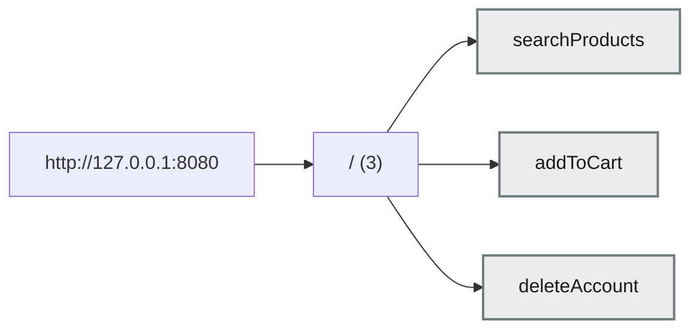

# BrowserRecon report — http://127.0.0.1:8080

| Field             | Value              |
| ----------------- | ------------------ |
| Session           | sess_0001          |
| Schema version    | 1.0.0              |
| Duration          | 2s                 |
| Rate profile      | normal             |
| Allowed methods   | GET, HEAD, OPTIONS |
| Discovery sources | browser            |
| Auth state        | anonymous          |
| AI mode           | off                |

> High-confidence coverage of the reachable and analyzable application surface under the supplied target policy, authentication state, runtime session, exploration budget and analysis limits. This is not a claim of complete application coverage, and cannot be.

## 1. Coverage summary

**Coverage score 0.95** — 95% of the surface this scan could reach was observed or analysed. This is a proportion of what was reachable under the policy, session and budget in force — not of the application. 2 dimension(s) found nothing to measure and are excluded.

| Dimension      | Observed | Discovered | Ratio |
| -------------- | -------- | ---------- | ----- |
| Pages          | 1        | 1          | 100%  |
| Routes         | 2        | 2          | 100%  |
| APIs (runtime) | 1        | 1          | 100%  |
| API sequences  | 1        | 1          | 100%  |
| Agentic tools  | 3        | 3          | 100%  |
| Origins        | 1        | 1          | 100%  |

_Ratio is of what this scan discovered, never of what the application has._

## 2. Workflows

_No workflows were detected._

## 3. API inventory

| Method | URL                                         | Status | Content type     | Party       | Role            |
| ------ | ------------------------------------------- | ------ | ---------------- | ----------- | --------------- |
| GET    | `http://127.0.0.1:8080/api/products/search` | 200    | application/json | first-party | application_api |

**Found via JS files:** 0 script(s) parsed. No endpoint candidates were found in them.

## 4. Agentic tools

**3 tool(s)** — unstated 3

| Tool             | Effect   | Page | Endpoint               | Description                               |
| ---------------- | -------- | ---- | ---------------------- | ----------------------------------------- |
| `searchProducts` | unstated | `/`  | `/api/products/search` | Search the catalog by keyword.            |
| `addToCart`      | unstated | `/`  | `/api/cart/items`      | Add a product to the current cart.        |
| `deleteAccount`  | unstated | `/`  | `/api/account`         | Permanently delete the signed-in account. |

_Tools are reported, never invoked (§7.2)._

## 5. Origins

| Origin                  | Requests | Classification |
| ----------------------- | -------- | -------------- |
| `http://127.0.0.1:8080` | 3        | first_party    |

> /home/you/.output/sess_0001 contains UNREDACTED captured data — cookies, tokens, authorization headers and request bodies. Do not commit it, attach it to a ticket, or sync it to cloud storage.
